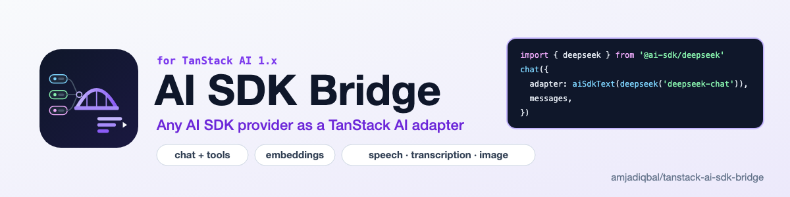

  <picture>
    <source media="(prefers-color-scheme: dark)" srcset="art/banner-dark.png">
    
  </picture>

# TanStack AI SDK Bridge

Use any Vercel AI SDK provider (`@ai-sdk/*` and community providers) as a TanStack AI adapter. Work in progress.
